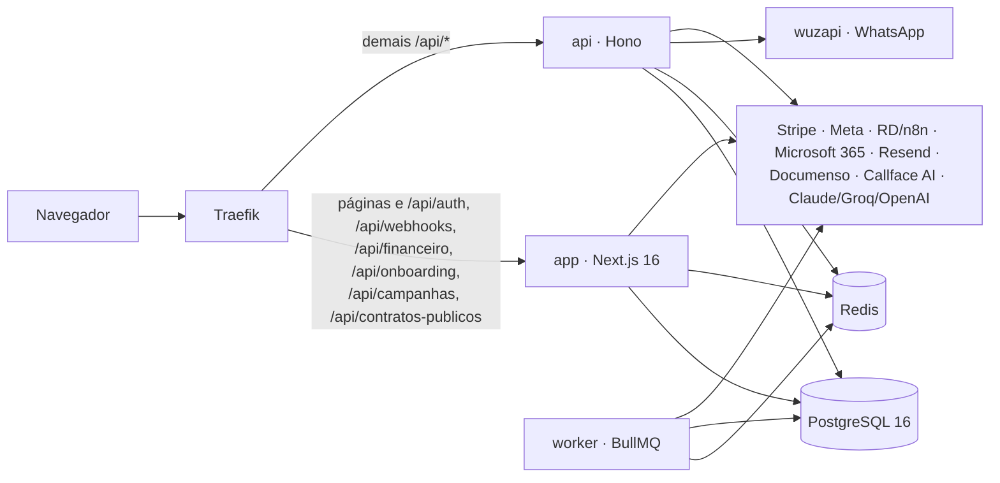
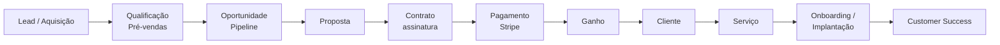

<h1 align="center">ONFACE</h1>

<p align="center">
  Plataforma operacional da jornada do cliente da Callface, da aquisição à retenção.
</p>

<p align="center">
  
  
  
  
  
  
</p>

| | |
|---|---|
| **Repositório** | `github.com/ImScottDev/OnFace-Ecossistema`, uma branch só: `main` |
| **Ambiente em validação** | https://dev.crm.callface.io (vira produção na virada) |
| **Produção hoje** | https://crm.callface.io roda o CRM anterior até a virada |
| **Design System vivo** | `/design` dentro do produto |

---

## O produto

O ONFACE é onde o time da Callface opera o cliente de ponta a ponta: o lead
entra (Meta, RD Station, site, WhatsApp), é qualificado em Pré-vendas, vira
oportunidade no Pipeline, recebe proposta, assina contrato, paga pelo Stripe,
é ganho e passa para Onboarding/Implantação e Customer Success.

A árvore do produto (`app/src/components/onface/navegacao.ts`, congelada pelo Kauã):

| Área | Telas |
|---|---|
| **Início** | o que precisa de atenção agora |
| **Atendimento** | caixa de entrada de WhatsApp, e-mail e ligações |
| **Vendas** | Pré-vendas · Pipeline · Propostas · Prospecção · Campanhas · Contatos & Empresas |
| **Operação** | Atividades · Calendário · Chamados (pendente) · Pós-vendas |
| **Clientes** | Visão Geral · Customer Success · Risco / Churn |
| **Automações** | Visão Geral · Fluxos · Cadências / Follow-ups · NEXO / Agentes IA · Execuções |
| **Insights** | Visão Geral · Relatórios · Performance |

Ajustes (membros, permissões, pipeline, integrações, ICP, WhatsApp, e-mail)
ficam no menu do usuário.

> O menu que a casca desenha (`components/onface/proto/CascaLiga.tsx`, `arvore()`)
> ainda não é derivado desta árvore e diverge dela em Calendário, Chamados,
> Risco / Churn e em dois rótulos. Unificar depende de decisão de produto.

---

## Arquitetura



São três processos construídos a partir do mesmo código (`app/`):

| Processo | Entrada | Imagem | Faz |
|---|---|---|---|
| **app** | `app/src/app` (Next App Router) | `Dockerfile` | telas, server actions, webhooks públicos |
| **api** | `app/src/api-server/index.ts` (Hono) | `Dockerfile.api` | a API interna `/api/*` consumida pelas telas |
| **worker** | `app/src/worker/index.ts` (BullMQ) | `Dockerfile.worker` | jobs agendados, outbox de eventos, sincronizações, agentes |

A divisão de `/api/*` entre Next e Hono é a regra do Traefik no
`docker-compose.yml`, espelhada em dev pelo `rewrite` do `app/next.config.ts` e
travada pelo teste `app/src/api-server/roteamento-traefik.test.ts`.

### Domínio



A regra de negócio mora em `app/src/lib/` (por domínio) e nos pacotes
`packages/` (`@onface/*`), que são o domínio já extraído do `app`:

| Pacote | Conteúdo |
|---|---|
| `@onface/acquisition` | aquisição e o board de Pré-vendas |
| `@onface/sales` | oportunidades e o board do Pipeline |
| `@onface/catalog` | catálogo comercial e ofertas |
| `@onface/identity` | identidade de pessoa/empresa (deduplicação) |
| `@onface/platform-database` · `@onface/platform-events` · `@onface/platform-storage` | plataforma: conexão, eventos de domínio, arquivos |
| `@onface/integrations-meta` · `@onface/integrations-callface-ai` | integrações com a Meta e com o banco do SaaS Callface AI |

Escrita comercial passa por portas únicas (`app/src/lib/vendas`); a decisão de
Ganho passa pela política da oferta (`app/src/lib/crm/won-evidence.ts`). As
travas de `app/src/lib/arquitetura/*.test.ts` mantêm essas regras.

---

## Estrutura do repositório

```
.
├── app/                         aplicação (Next + API Hono + worker)
│   ├── src/app/
│   │   ├── (produto)/           telas do produto, todas com sessão (91)
│   │   ├── (enderecos-antigos)/ redirects das URLs do CRM anterior (favoritos do time)
│   │   ├── api/                 rotas Next: webhooks, auth, contratos públicos…
│   │   ├── login · p · checkout · impl-pabx · impl-white-label · …  páginas públicas
│   │   └── onface.css           tokens do Design System
│   ├── src/api-server/          API Hono (server.ts monta as rotas de routes/)
│   ├── src/worker/              worker BullMQ
│   ├── src/components/
│   │   ├── ui/                  biblioteca de componentes (shadcn) — a fonte do DS
│   │   ├── onface/              casca, Design System, telas e módulos ONFACE
│   │   │   └── proto/           telas convertidas do handoff de design (ver abaixo)
│   │   └── crm/ · crm2/         componentes anteriores ainda usados por telas vivas
│   ├── src/lib/                 domínio por área (vendas, crm, cs, financeiro, automacoes, ai-platform…)
│   │   └── db/                  schema Drizzle, migrations e scripts de carga da virada
│   └── src/scripts/             verificadores, smokes, aceites e backfills
├── packages/                    domínio extraído (@onface/*)
├── docs/                        produto, design, operação e decisões (ver docs/README.md)
├── scripts/                     dev local, carga da virada, runners de smoke/aceite
├── docker-compose.yml           o ambiente publicado de desenvolvimento
├── Dockerfile · Dockerfile.api · Dockerfile.worker
└── deploy.sh                    publica um commit no dev
```

**Telas do handoff (`components/onface/proto`).** Boa parte das telas veio do
Claude Design como `.dc.html` e foi convertida por máquina
(`scripts/dc-para-tsx.mjs`). Cada tela tem três peças: `*Desenho` (o markup
convertido), `*Liga` (a lógica gerada) e `*Proto` (o adaptador que liga ao dado
real). As telas geradas navegam por endereços do protótipo
(`/onface-preview/...`), traduzidos para a rota real em
`proto/rota-do-desenho.ts` antes de qualquer navegação. A receita está em
`docs/design/COMO-LIGAR-UMA-TELA.md`.

---

## Banco de dados

- PostgreSQL 16. Schema declarado em `app/src/lib/db/schema.ts` (Drizzle).
- **Migrations são o runner próprio**, não o drizzle-kit:
  `app/src/lib/db/migrar.ts` aplica os `.sql` de `app/src/lib/db/migrations/`
  em ordem, registra hash em `_migracoes_aplicadas` e recusa arquivo já aplicado
  que mudou. **Nunca edite uma migration aplicada; crie a próxima.**
- `app/src/lib/db/carga/` é a receita de carga da virada (dump de produção →
  modelo novo), rodada por `scripts/ensaio-carga.sh` e conferida por
  `scripts/checar-carga.sh`.

```bash
cd app
pnpm db:migrar:check   # lista o que falta aplicar
pnpm db:migrar         # aplica
```

---

## Ambientes

| Ambiente | Onde | Banco | Como chega código |
|---|---|---|---|
| **Local** | sua máquina, `scripts/dev.sh` | Postgres do Homebrew; dado fresco com `scripts/refresh-dev-db.sh` | `pnpm dev` |
| **Dev publicado** | https://dev.crm.callface.io · EC2 `/opt/callface/crm2-dev` · compose `crm2-dev` | Postgres próprio do compose, carregado com dado de produção | `./deploy.sh dev` |
| **Produção** | https://crm.callface.io · EC2 `/opt/callface/crm` | Postgres de produção | só pela virada, com OK do Kauã (`docs/operacao/virada/`) |

O dev é isolado de produção: containers `callface-crm2-dev-*`, rede e volumes
próprios, e WhatsApp com allowlist de saída. Stripe fica em `STRIPE_CHECKOUT_MODE=mock`.

---

## Desenvolvimento local

Pré-requisitos: Node 22, pnpm 11, Postgres 16 e Redis (Homebrew).

```bash
pnpm install                    # na raiz: workspace com app/ e packages/
cp .env.example app/.env        # preencha o núcleo (ver abaixo)
cd app && pnpm db:migrar        # schema
cd .. && ./scripts/dev.sh       # Next :3000 + API :3001 + worker
```

`API_PORT` (padrão 3001) é a porta que a API escuta **e** para onde o `next dev`
reescreve `/api/*`. Não rode `pnpm build` com o `next dev` de pé: o build
sobrescreve `.next` e o dev passa a servir CSS velho.

### Variáveis

Todas estão documentadas em `.env.example`. O deploy recusa subir sem o núcleo
(`app/src/scripts/checar-env-runtime.ts`):

| Grupo | Variáveis |
|---|---|
| Núcleo | `DATABASE_URL`, `REDIS_URL`, `NEXTAUTH_SECRET`, `NEXTAUTH_URL` |
| Entrada de leads | `RD_WEBHOOK_SECRET`, `META_LEADIDS_WEBHOOK_SECRET` (webhooks fail-closed) |
| Integrações (avisadas) | Stripe, Documenso, e-mail, Microsoft 365, WhatsApp (wuzapi), Callface AI |

A URL pública de links (e-mail, proposta, checkout, assinatura) sai de um lugar
só: `app/src/lib/app-url.ts`.

---

## Comandos

| Onde | Comando | O que faz |
|---|---|---|
| raiz | `pnpm dev` · `pnpm build` · `pnpm test` · `pnpm typecheck` | atalhos para o `app` |
| app | `pnpm test` | toda a suíte `node:test` (travas de arquitetura, domínio, testes com banco) |
| app | `pnpm ds:all` | contraste e conformidade do Design System |
| app | `pnpm check:env` · `pnpm check:pre-deploy` | ambiente e prontidão |
| app | `pnpm check:vendas` · `pnpm aceite:vendas` · `pnpm aceite:won-cs` | domínio comercial contra o banco |
| app | `npx tsx --env-file=.env src/scripts/checar-rotas-onface.ts` | abre logado toda tela do menu e os detalhes, e acusa 404/500, erro de compilação e tela vazia (`BASE=` aponta para outro ambiente) |
| raiz | `scripts/rodar-smokes.sh` · `scripts/rodar-aceites.sh` | baterias completas contra o banco do `.env` |
| raiz | `scripts/ensaio-carga.sh` | ensaio da carga da virada num banco rascunho local |

O CI (`.github/workflows/portao.yml`) roda typecheck e as travas de arquitetura
em todo push na `main` e em pull request.

---

## Deploy

```bash
./deploy.sh dev
```

Publica **o commit atual** (recusa árvore suja) em `dev.crm.callface.io`:
envia via `git archive`, espelha a pasta do servidor com `--delete` protegendo
`.env`, uploads, segredos do Documenso e backups; constrói as três imagens uma
por vez com `--cpuset-cpus=1` (a EC2 é compartilhada com produção); confere o
ambiente e aplica migrations **com a imagem nova**; troca worker, api e app;
espera o healthcheck e grava o commit em `.onface-release`.

Produção não tem alvo no script: a virada é um procedimento próprio
(`docs/operacao/virada/`) e exige aprovação explícita do Kauã.

---

## Integrações

| Integração | Uso | Onde |
|---|---|---|
| Meta (Lead Ads, CAPI, Ads) | entrada de lead e devolução de conversão | `packages/integrations/meta`, `app/src/app/api/webhooks/meta-*` |
| RD Station (via n8n) | entrada de lead | `app/src/app/api/webhooks/rd-lead` |
| Stripe | checkout, assinatura, faturas, portal do cliente | `app/src/lib/integrations/stripe-*`, `app/src/app/api/webhooks/stripe` |
| Documenso | assinatura eletrônica de contrato | `app/src/lib/crm/signature/` |
| WhatsApp (wuzapi) | atendimento | `app/src/api-server/routes/whatsapp.ts` |
| Microsoft 365 | e-mail e agenda das closers | `app/src/lib/email`, `app/src/lib/calendario` |
| Resend | e-mail transacional | `app/src/lib/email` |
| Callface AI | dados de uso do SaaS e webhooks | `packages/integrations/callface-ai` |
| Claude / Groq / OpenAI | NEXO, agentes e SDR | `app/src/lib/ai-platform`, `app/src/lib/ai` |

---

## Documentação

`docs/README.md` é o índice: spec do produto (Módulo 01 de Vendas), guias de
design e do handoff, operação (virada, Stripe, protocolo de trabalho) e o
registro datado de decisões. `PRODUCT.md` e `DESIGN.md` (raiz) são lidos pelas
ferramentas de design. Regras para agentes de código: `AGENTS.md`.
