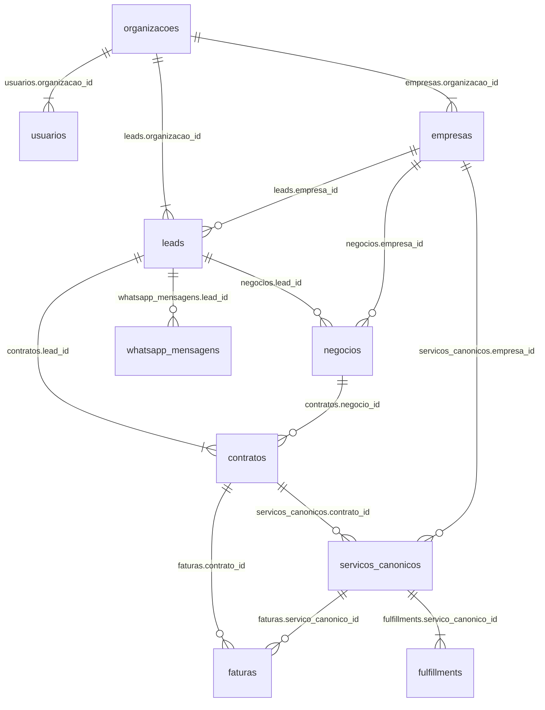
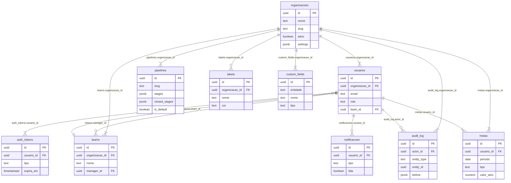
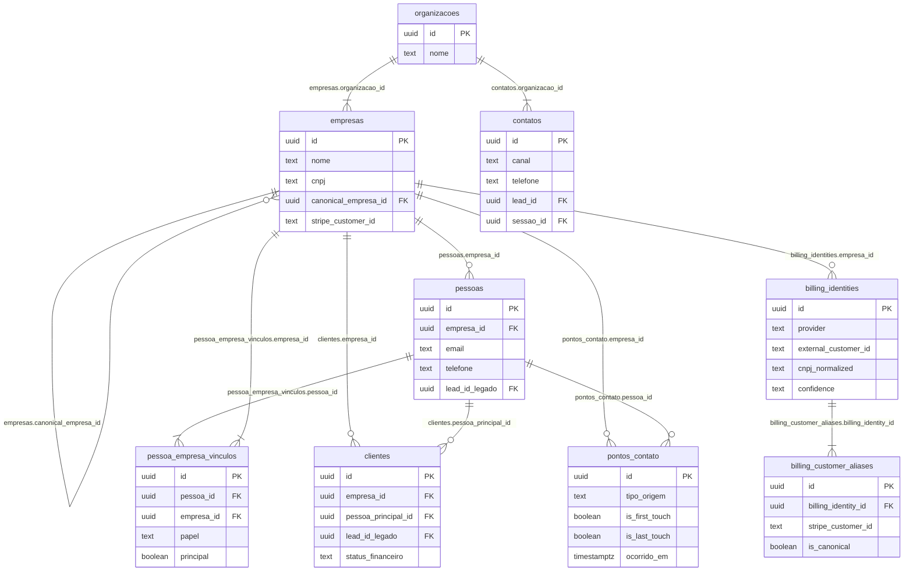
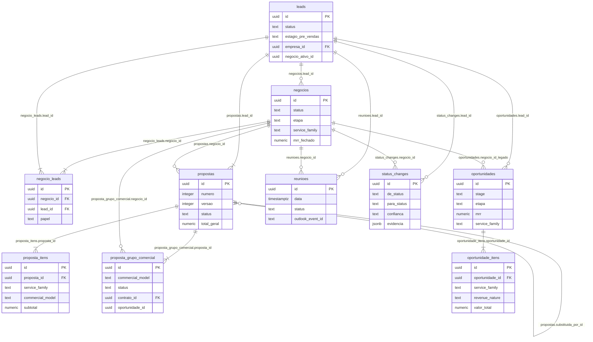
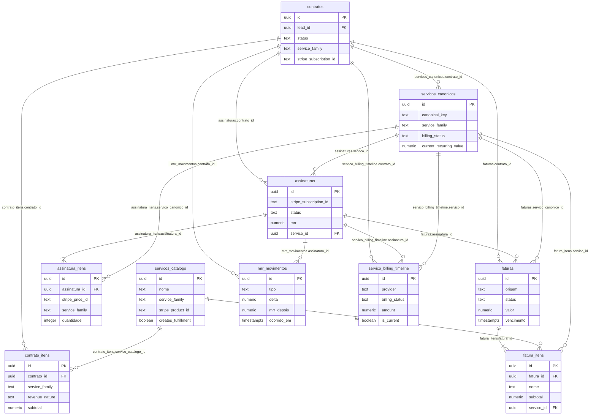
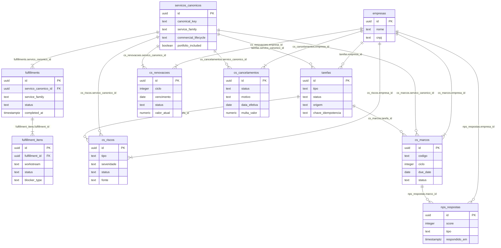
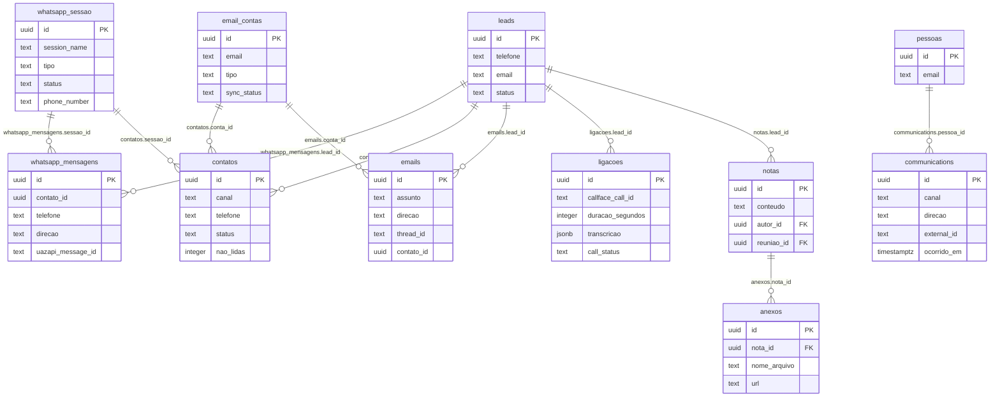
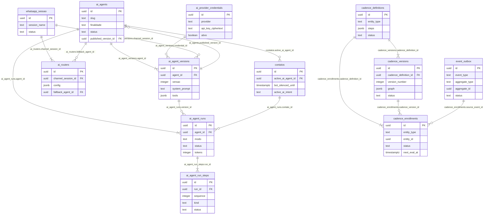

# 06. Diagrama AS-IS por area

Estado real do banco `callface_crm` (carga de producao de 20/09/2026). Documento descritivo:
nao propoe arquitetura, nao indica qual tabela deve prevalecer, nao recomenda migracao.

Fonte de cada numero e de cada relacao:

| Fato | Origem |
|---|---|
| Numero de linhas por tabela | `_raw/tabelas-contagem-exata.txt` |
| Toda relacao desenhada | `_raw/foreign-keys.txt` |
| Nullability da FK (cardinalidade) | coluna 7 de `_raw/foreign-keys.txt` |
| Colunas e tipos das entidades | `_raw/colunas.txt` |
| Colunas `*_id` sem FK declarada | `_raw/ids-sem-fk.txt` |
| Contagens de NULL citadas nas notas | queries `SELECT count(*)` executadas em 20/09/2026, reproduzidas abaixo de cada nota |

## Regras usadas para desenhar

1. Toda aresta existe como foreign key declarada em `_raw/foreign-keys.txt`. Nenhuma ligacao foi
   inferida por nome de coluna.
2. Cardinalidade pela nullability real da coluna filha: FK nullable vira `||--o{`, FK `NOT NULL`
   vira `||--|{`.
3. Cada entidade mostra a PK e no maximo quatro colunas, escolhidas para explicar o papel dela.
   Nenhuma entidade esta completa; a lista integral esta em `_raw/colunas.txt`.
4. Tabelas que parecem ligadas mas nao tem FK entre si aparecem apenas no texto, nunca como aresta.
5. Tipos abreviados: `timestamptz` = `timestamp with time zone`.

## Visao geral

Linhas hoje:

| Tabela | Linhas |
|---|---|
| organizacoes | 1 |
| usuarios | 16 |
| empresas | 2199 |
| leads | 3989 |
| negocios | 1562 |
| contratos | 742 |
| servicos_canonicos | 438 |
| faturas | 951 |
| fulfillments | 25 |
| whatsapp_mensagens | 25363 |

O que o desenho revela: nao existe uma unica espinha dorsal. `leads` e `empresas` sao dois pontos
de entrada paralelos, e as duas se repetem lado a lado em quase toda tabela a jusante
(`negocios`, `contratos`, `faturas`, `servicos_canonicos` carregam ambas as FKs). A unica FK
obrigatoria para uma entidade de negocio no caminho comercial e `contratos.lead_id NOT NULL`
(`_raw/foreign-keys.txt` linha 185): o contrato e obrigado a apontar para um lead, e apenas
opcionalmente para um negocio. `organizacoes` tem uma unica linha e 120 FKs apontando para ela
(`_raw/mais-referenciadas.txt`), ou seja, o banco e multi-tenant no schema e single-tenant no dado.

## A. Tenant / Auth

Linhas hoje:

| Tabela | Linhas |
|---|---|
| organizacoes | 1 |
| usuarios | 16 |
| teams | 0 |
| auth_tokens | 21 |
| audit_log | 21 |
| pipelines | 2 |
| labels | 3 |
| custom_fields | 0 |
| metas | 13 |
| notificacoes | 3203 |

O que o desenho revela: a camada de tenant existe estruturalmente e quase nao tem dado.
`teams` esta vazia (`_raw/tabelas-contagem-exata.txt` linha 145) enquanto `usuarios.team_id`
e a FK `usuarios_team_id_fkey` continuam declaradas, e `teams.manager_id` fecha um ciclo
`usuarios -> teams -> usuarios`. `custom_fields` esta vazia mas varias tabelas de negocio
carregam a coluna `campos_custom jsonb` (`leads`, `negocios`, `empresas`), ou seja, o campo
customizado mora no JSONB e nao no catalogo. `audit_log` tem 21 linhas para um banco com 30876
linhas em `correction_change_log`: a trilha de auditoria de aplicacao nao e onde o historico
esta. `audit_log.entity_id` nao tem FK (`_raw/ids-sem-fk.txt` linha 20), e polimorfico via
`entity_type`. `labels.organizacao_id` e a unica chave de tenant nullable desta area
(`_raw/foreign-keys.txt` linha 268).

## B. Organizacao / Pessoa

Linhas hoje:

| Tabela | Linhas |
|---|---|
| organizacoes | 1 |
| empresas | 2199 |
| pessoas | 0 |
| pessoa_empresa_vinculos | 0 |
| contatos | 1663 |
| clientes | 275 |
| pontos_contato | 0 |
| billing_identities | 224 |
| billing_customer_aliases | 2 |

O que o desenho revela: o modelo de pessoa esta desenhado e vazio. `pessoas` tem 0 linhas
(`_raw/tabelas-contagem-exata.txt` linha 124) e seis tabelas apontam para ela
(`_raw/mais-referenciadas.txt`), entre elas `clientes.pessoa_principal_id`, `oportunidades.pessoa_id`
e `communications.pessoa_id`. Como a tabela esta vazia, toda FK que aponta para `pessoas` esta
necessariamente NULL em 100% das linhas. `pessoa_empresa_vinculos`, a tabela pensada para o vinculo
N:N pessoa-empresa, tambem esta vazia.

`contatos` (1663 linhas) aparece nesta area por ser a entidade de pessoa que de fato tem dado, mas
nao tem nenhuma FK para `pessoas` nem para `empresas`: as unicas ligacoes declaradas sao
`contatos.lead_id -> leads`, `contatos.sessao_id -> whatsapp_sessao`, `contatos.conta_id ->
email_contas` e `contatos.responsavel_id -> usuarios`. Por isso a caixa aparece ligada apenas a
`organizacoes` no desenho.

`empresas.canonical_empresa_id` e auto-referencia com `ON DELETE SET NULL`
(`_raw/foreign-keys.txt` linha 230): existe deduplicacao de empresa dentro da propria tabela.
`leads.canonical_lead_id` existe como coluna mas nao tem FK declarada (`_raw/ids-sem-fk.txt`),
ou seja, a mesma ideia de canonico esta implementada de dois jeitos diferentes.

`clientes` (275 linhas) e referenciada por uma unica FK no banco inteiro, `notas.cliente_id`
(`_raw/mais-referenciadas.txt`, linha `1 clientes`).

Query das contagens citadas: `SELECT count(*) FROM leads WHERE empresa_id IS NULL;` devolveu 1641
de 3989 leads sem empresa vinculada.

## C. Aquisicao / Vendas

Linhas hoje:

| Tabela | Linhas |
|---|---|
| leads | 3989 |
| negocios | 1562 |
| negocio_leads | 1199 |
| propostas | 1550 |
| proposta_itens | 2701 |
| proposta_grupo_comercial | 0 |
| oportunidades | 0 |
| oportunidade_itens | 0 |
| reunioes | 295 |
| status_changes | 5923 |

O que o desenho revela: existem dois modelos comerciais coexistindo no schema, e apenas um tem dado.
`leads + negocios + propostas` esta carregado; `oportunidades + oportunidade_itens +
proposta_grupo_comercial` esta com 0 linhas (`_raw/tabelas-contagem-exata.txt` linhas 120, 129).
O modelo vazio nao e isolado: `contratos.grupo_comercial_id`, `faturas.grupo_comercial_id` e
`checkouts.grupo_comercial_id` apontam para `proposta_grupo_comercial`, e `oportunidade_itens`
carrega tres colunas de retrocompatibilidade (`contrato_item_id_legado`, `proposta_item_id_legado`,
`negocio_id_legado` em `oportunidades`). A tabela vazia esta cabeada como se fosse o centro.

`negocio_leads` e a tabela N:N entre negocio e lead (1199 linhas), e existe simultaneamente a
FK direta `negocios.lead_id`: a mesma relacao esta modelada duas vezes.

Classificacao comercial pouco preenchida: `SELECT count(*) FROM negocios WHERE service_family IS
NULL;` devolveu 1560 de 1562 negocios. `SELECT count(*) FROM negocios WHERE empresa_id IS NULL;`
devolveu 482; `... WHERE lead_id IS NULL` devolveu 64.

`propostas.substituida_por_id` e auto-referencia (`_raw/foreign-keys.txt` linha 371): o versionamento
de proposta mora dentro da propria tabela, junto com as colunas `numero` e `versao`.
`SELECT count(*) FROM propostas WHERE contrato_id IS NULL;` devolveu 1401 de 1550.

Tabelas desta area que aparecem soltas e por isso nao foram desenhadas com aresta:
`campanhas` (18 linhas) so tem FK para `organizacoes`, nao ha FK ligando campanha a lead;
`meta_lead_staging` (576 linhas) nao tem nenhuma FK entrando nem saindo
(`_raw/sem-fk-nenhuma.txt`), e liga a campanha por `ad_id`, `adset_id`, `campaign_id` e `fb_lead_id`
como texto livre (`_raw/ids-sem-fk.txt`). `leads` carrega `meta_ad_id`, `meta_adset_id` e
`meta_campaign_id`, tambem sem FK.

## D. Contrato / Financeiro

Linhas hoje:

| Tabela | Linhas |
|---|---|
| contratos | 742 |
| contrato_itens | 487 |
| servicos_catalogo | 220 |
| servicos_canonicos | 438 |
| assinaturas | 355 |
| assinatura_itens | 0 |
| faturas | 951 |
| fatura_itens | 226 |
| mrr_movimentos | 665 |
| servico_billing_timeline | 144 |

O que o desenho revela: quatro entidades disputam o papel de "o que o cliente comprou"
(`contrato_itens`, `servicos_catalogo`, `servicos_canonicos`, `assinatura_itens`) e todas as
ligacoes entre elas e o faturamento sao opcionais. Das 18 arestas desta area, 16 sao `||--o{`:
as duas obrigatorias sao apenas item para cabecalho (`assinatura_itens.assinatura_id` e
`fatura_itens.fatura_id`).

`servicos_canonicos` e a tabela que concentra a semantica de servico (438 linhas, distribuicao por
`SELECT service_family, count(*) FROM servicos_canonicos GROUP BY 1`: CALLFACE_AI 237, PABX 187,
WHITE_LABEL 13, UNKNOWN 1), mas a ligacao dela com a cobranca nao esta materializada:
`SELECT count(*) FROM faturas WHERE servico_canonico_id IS NULL;` devolveu 951, ou seja, as 951
faturas do banco tem essa coluna NULL. A FK existe (`_raw/foreign-keys.txt` linha 253) e nunca
foi preenchida.

Outras contagens de NULL desta area, todas por `SELECT count(*)`:
`contratos.negocio_id` NULL em 406 de 742; `contrato_itens.contrato_id` NULL em 44 de 487
(a FK e nullable, entao o item pode existir sem contrato); `assinaturas.contrato_id` NULL em 97
de 355; `assinaturas.servico_id` NULL em 211 de 355; `faturas.contrato_id` NULL em 844 de 951;
`faturas.empresa_id` NULL em 177 de 951; `proposta_itens.servico_catalogo_id` NULL em 112 de 2701.

`assinatura_itens` esta vazia (`_raw/tabelas-contagem-exata.txt` linha 36) embora `assinaturas`
tenha 355 linhas: o detalhe de item de assinatura Stripe nao esta no banco, so o agregado.
`catalogo_precos` tambem esta vazia (linha 61) enquanto `proposta_itens.catalogo_preco_id` e
`oportunidade_itens.catalogo_preco_id` apontam para ela; os precos praticados aparecem como
`stripe_price_id` em texto sem FK (`_raw/ids-sem-fk.txt`).

`service_ledger_entries` (302 linhas) nao foi desenhada para caber no limite; ela liga a
`service_ledger_batches` e a `servicos_canonicos`, e tem trigger de imutabilidade
`trg_closed_service_ledger_entries_immutable` em UPDATE e DELETE (`_raw/triggers.txt`), o unico
mecanismo de imutabilidade declarado no banco fora de `tarefas`.

Existe uma unica view no banco, `current_service_portfolio` (`_raw/views.txt`), e a coluna
`organizacao_id` dela aparece na lista de ids sem FK por ser view.

## E. Pos-venda / CS

Linhas hoje:

| Tabela | Linhas |
|---|---|
| empresas | 2199 |
| servicos_canonicos | 438 |
| fulfillments | 25 |
| fulfillment_itens | 1659 |
| tarefas | 462 |
| cs_riscos | 514 |
| cs_marcos | 0 |
| cs_renovacoes | 0 |
| cs_cancelamentos | 0 |
| nps_respostas | 0 |

O que o desenho revela: a area esta modelada em torno de `empresas + servicos_canonicos`, com
FK obrigatoria para `empresas` em todas as quatro tabelas `cs_*`, mas apenas uma delas tem dado.
`cs_marcos`, `cs_renovacoes`, `cs_cancelamentos` e `nps_respostas` estao com 0 linhas
(`_raw/tabelas-contagem-exata.txt`, linhas 78 e seguintes), ou seja, a jornada de CS esta
desenhada e nao esta sendo gravada.

`cs_riscos` tem 514 linhas mas nao esta ancorada em servico nem em tarefa:
`SELECT count(*) FROM cs_riscos WHERE servico_canonico_id IS NULL;` devolveu 514 (todas) e
`... WHERE tarefa_id IS NULL` devolveu 478 de 514. O risco esta ligado apenas a empresa.

Mesmo padrao em `tarefas`: `SELECT count(*) FROM tarefas WHERE servico_canonico_id IS NULL;`
devolveu 462, isto e, nenhuma das 462 tarefas aponta para um servico. `tarefas` tem trigger
`trg_tarefas_sincronizar_status` em INSERT e UPDATE (`_raw/triggers.txt`), sinal de que
`concluida` e `status` sao mantidos em sincronia por gatilho de banco.

`fulfillments` cobre uma fracao do portfolio: 25 fulfillments para 438 servicos canonicos, e a
distribuicao por `SELECT status, count(*) FROM fulfillments GROUP BY 1` e COMPLETED 18,
NOT_STARTED 4, READY_FOR_VALIDATION 2, IN_PROGRESS 1. Os 1659 `fulfillment_itens` se concentram
nesses 25 registros.

`clientes` (275 linhas), que seria a entidade de carteira, nao tem FK vindo de nenhuma tabela
`cs_*` e por isso nao aparece no desenho.

## F. Comunicacao

Linhas hoje:

| Tabela | Linhas |
|---|---|
| leads | 3989 |
| contatos | 1663 |
| whatsapp_sessao | 7 |
| whatsapp_mensagens | 25363 |
| email_contas | 8 |
| emails | 4460 |
| ligacoes | 4938 |
| notas | 5002 |
| anexos | 0 |
| communications | 0 |
| pessoas | 0 |

O que o desenho revela: a tabela mais volumosa do banco, `whatsapp_mensagens` (25363 linhas), e a
menos amarrada. Ela nao tem coluna `organizacao_id` (conferido em `_raw/colunas.txt`), nao tem FK
para `organizacoes`, e sua ligacao com a conversa e uma coluna `contato_id` sem FK declarada
(`_raw/ids-sem-fk.txt` linha 113). Por isso `contatos` e `whatsapp_mensagens` aparecem no desenho
sem aresta direta entre si, mesmo sendo obviamente a mesma conversa.

A FK que existe, `whatsapp_mensagens.lead_id`, quase nao e usada:
`SELECT count(*) FROM whatsapp_mensagens WHERE lead_id IS NULL;` devolveu 24380 de 25363.
`... WHERE contato_id IS NULL` devolveu 789, ou seja, 24574 mensagens se identificam pela coluna
sem FK e nao pela FK declarada.

O mesmo padrao aparece em `emails`: a coluna `contato_id` nao tem FK (`_raw/ids-sem-fk.txt`
linha 52) e `SELECT count(*) FROM emails WHERE contato_id IS NULL;` devolveu 4460, todas as linhas.
O vinculo real de e-mail e `emails.lead_id` e `emails.conta_id`.

`communications`, a tabela desenhada como canal unificado, esta vazia e depende de `pessoas`, que
tambem esta vazia. `anexos` esta vazia (0 linhas) enquanto `anexos_legado` tem 1980 linhas com
`entidade_id` sem FK (`_raw/ids-sem-fk.txt` linha 10), polimorfico por `entidade_tipo`. A
distribuicao por `SELECT entidade_tipo, count(*) FROM anexos_legado GROUP BY 1` e: contrato 1164,
negocio 615, notes 123, empresa 44, desconhecido 19, emails 14, lead 1.

Outras contagens: `SELECT count(*) FROM ligacoes WHERE negocio_id IS NULL;` devolveu 4464 de 4938;
`SELECT count(*) FROM notas WHERE reuniao_id IS NULL;` devolveu 5002, todas.

`lead_user_unread` (217 linhas) guarda contadores de nao lidos por par lead-usuario e duplica
colunas que ja existem em `leads` (`whatsapp_nao_lidas`, `email_nao_lidos`) e em `contatos`
(`nao_lidas`); nao foi desenhada para caber no limite de caixas.

## G. IA / Automacao

Linhas hoje:

| Tabela | Linhas |
|---|---|
| ai_agents | 0 |
| ai_agent_versions | 0 |
| ai_agent_runs | 0 |
| ai_agent_run_steps | 0 |
| ai_provider_credentials | 0 |
| ai_routers | 0 |
| whatsapp_sessao | 7 |
| contatos | 1663 |
| cadence_definitions | 0 |
| cadence_versions | 0 |
| cadence_enrollments | 0 |
| event_outbox | 0 |

O que o desenho revela: a area inteira esta vazia. Das 33 tabelas com prefixo `ai_` em
`_raw/tabelas-contagem-exata.txt`, apenas `ai_models` tem dado, com 6 linhas, e ela nao tem
nenhuma FK entrando nem saindo (`_raw/sem-fk-nenhuma.txt`). As duas caixas com dado no desenho,
`whatsapp_sessao` e `contatos`, pertencem a area de comunicacao e estao aqui porque a IA se ancora
nelas: `ai_routers.channel_session_id` e `NOT NULL` para `whatsapp_sessao`, e
`contatos.active_ai_agent_id` aponta para `ai_agents`.

`ai_agents` e `ai_agent_versions` formam um ciclo declarado: a versao aponta para o agente com
`CASCADE NOT NULL` (`_raw/foreign-keys.txt` linha 11) e o agente aponta de volta para a versao
publicada com `SET NULL` (linha 18). O mesmo padrao ponteiro-para-versao se repete em
`ai_memory_pointers`, `ai_skill_pointers` e `cadence_definition_pointers`, todos com `RESTRICT`
no ponteiro.

A cadencia tambem existe duas vezes. O modelo novo (`cadence_definitions`, `cadence_versions`,
`cadence_enrollments`, `cadence_enrollment_events`, `cadence_definition_pointers`) esta com 0
linhas; o legado `cadencia_execucoes` tem 1273 linhas (`_raw/tabelas-contagem-exata.txt` linha 54)
e nao tem nenhuma FK para a familia `cadence_*`: ele liga direto em `leads`, `whatsapp_sessao` e
`usuarios`. As duas nao se tocam no schema.

`cadence_enrollments.entity_id` nao tem FK (`_raw/ids-sem-fk.txt` linha 32), e polimorfico via
`entity_type`, mesmo padrao de `event_outbox.aggregate_id`, `audit_log.entity_id`,
`entity_labels.entity_id` e `anexos_legado.entidade_id`.

O SDR antigo (`ai_sdr_config`, `ai_sdr_contato_state`, `ai_sdr_logs`) tambem esta com 0 linhas, e
`ai_sdr_logs.contato_id` e `ai_sdr_logs.lead_id` sao colunas sem FK (`_raw/ids-sem-fk.txt`).

## Observacao transversal: chave de tenant

31 tabelas nao tem coluna `organizacao_id`, apurado por
`comm -23 <(cut -d'|' -f1 colunas.txt | sort -u) <(grep '|organizacao_id|' colunas.txt | cut -d'|' -f1 | sort -u)`.
Alem de `organizacoes` e das duas tabelas de controle de carga (`_carga_contagem_antes`,
`_migracoes_aplicadas`), a lista inclui tabelas com volume relevante:
`whatsapp_mensagens` (25363), `correction_change_log` (30876), `status_changes` (5923),
`proposta_itens` (2701), `contrato_itens` (487), `fatura_itens` (226), `negocio_leads` (1199),
`notificacoes` (3203), `lead_user_unread` (217), `meta_lead_staging` (576), `auth_tokens` (21),
`eventos` (0), `lead_labels` (161), `contato_labels` (0), `negocio_labels` (0), `lead_listas` (0),
`ai_models` (6), `callface_ai_external_identities` (0), `callface_ai_reconciliation_candidates` (0),
`callface_ai_tenant_snapshots` (0), `callface_ai_usage_events` (0), `cadence_enrollment_events` (0),
`email_sequencia_execucoes` (0), `email_sequencia_passos` (0), `proposta_grupo_comercial_itens` (0),
`reconciliation_changes` (413), `correction_runs` (6), `billing_customer_aliases` (2).

Nessas tabelas o isolamento por tenant so pode vir por join com a tabela pai. Com uma unica
organizacao no banco (`organizacoes` = 1 linha) isso nao produz efeito observavel hoje.

## NAO CONFIRMADO

Pontos que este levantamento nao consegue afirmar com a evidencia disponivel:

- **Intencao por tras dos pares de modelos duplicados.** O banco mostra `leads/negocios/propostas`
  cheio e `pessoas/oportunidades/proposta_grupo_comercial` vazio, e mostra `cadencia_execucoes`
  cheio e `cadence_*` vazio. Qual dos dois e o modelo em vigor, qual foi abandonado e qual esta
  em construcao: NAO CONFIRMADO. O schema nao carrega essa informacao e nenhuma query responde isso.
- **Como o isolamento por tenant e garantido nas 31 tabelas sem `organizacao_id`.** Se existe
  filtro na camada de aplicacao ou politica de RLS: NAO CONFIRMADO. Nao ha policy declarada nos
  arquivos extraidos e o codigo em `app/src/lib/db/schema.ts` nao foi auditado para este documento.
- **Se `contatos` e `pessoas` representam a mesma entidade de dominio.** Nao ha FK, nao ha coluna
  de correspondencia e nao ha chave natural comum declarada entre as duas: NAO CONFIRMADO.
- **Se `whatsapp_mensagens.contato_id` aponta de fato para `contatos.id`.** O tipo e `uuid` e o
  nome sugere isso, mas nao ha FK declarada e este documento nao rodou a verificacao de integridade
  referencial: NAO CONFIRMADO.
- **Por que `faturas.servico_canonico_id` esta 100% NULL.** Se a coluna e nova, se o backfill
  falhou ou se o vinculo nunca foi implementado: NAO CONFIRMADO.
- **Definicao da view `current_service_portfolio`.** `_raw/views.txt` registra apenas o nome;
  o corpo da view nao foi lido neste documento: NAO CONFIRMADO.
- **Significado de `labels.organizacao_id` nullable.** Se representa label global do produto ou
  se e residuo de migracao: NAO CONFIRMADO.
